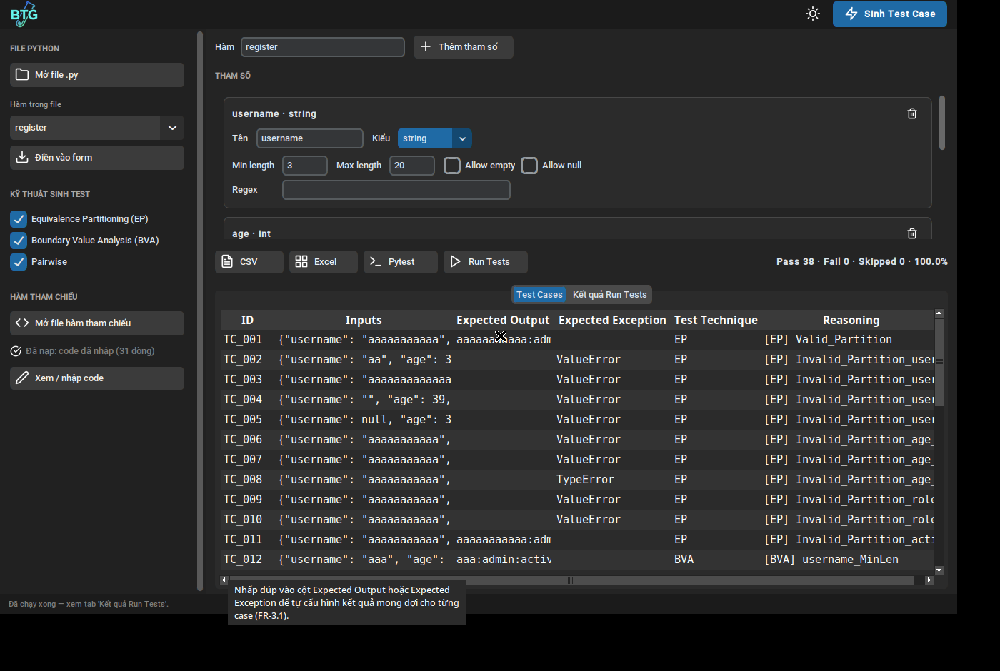

# BTG — Tài liệu chức năng & hướng dẫn sử dụng

Tài liệu này dành cho thành viên trong team để nắm toàn bộ chức năng của
dự án **BTG (Black-box Test Generator)**: phần mềm sinh test case tự động
bằng phương pháp **kiểm thử hộp đen** cho các hàm Python, đóng gói dạng
ứng dụng desktop (CustomTkinter).

> Đối chiếu yêu cầu: mỗi chức năng đều ghi kèm mã yêu cầu trong tài liệu
> SRS của dự án (FR-x.x / NFR-0x) để tiện tra cứu khi báo cáo.

## Mục lục

1. [Tổng quan](#1-tổng-quan)
2. [Cài đặt & chạy](#2-cài-đặt--chạy)
3. [Kiến trúc & cấu trúc mã nguồn](#3-kiến-trúc--cấu-trúc-mã-nguồn)
4. [Hướng dẫn sử dụng từng chức năng](#4-hướng-dẫn-sử-dụng-từng-chức-năng)
5. [Ví dụ hoàn chỉnh từ đầu đến cuối](#5-ví-dụ-hoàn-chỉnh-từ-đầu-đến-cuối)
6. [Quy ước làm việc cho team](#6-quy-ước-làm-việc-cho-team)
7. [FAQ & xử lý lỗi thường gặp](#7-faq--xử-lý-lỗi-thường-gặp)

---

## 1. Tổng quan

BTG giải quyết bài toán: *cho một hàm Python và đặc tả miền dữ liệu của
các tham số, hãy tự động sinh ra bộ test case chất lượng cao* — thay vì
người kiểm thử phải ngồi nghĩ từng giá trị.

Ba kỹ thuật kiểm thử hộp đen được áp dụng (đều là kỹ thuật dựa trên
**đặc tả**, không phân tích code bên trong hàm):

| Kỹ thuật | Ý tưởng | Mã SRS |
|---|---|---|
| **Equivalence Partitioning (EP)** | Chia miền dữ liệu thành các vùng tương đương; mỗi vùng lấy 1 giá trị đại diện. Sinh case hợp lệ + case không hợp lệ theo *Single Fault Assumption* (mỗi case lỗi chỉ sai đúng 1 tham số) | FR-2.1 |
| **Boundary Value Analysis (BVA)** | Lỗi thường nằm ở biên: sinh các điểm `min-1, min, min+1, max-1, max, max+1` cho số và độ dài chuỗi | FR-2.2 |
| **Pairwise** | Khi hàm có nhiều tham số, thay vì tổ hợp toàn bộ (nổ tổ hợp), chỉ cần bao phủ mọi *cặp* giá trị giữa các tham số. Khuyên dùng khi > 3 tham số | FR-2.3 |

Kiểu dữ liệu hỗ trợ: `int`, `float`, `string` (độ dài, regex), `enum`
(tập giá trị cố định), `bool`.

Vì sao BTG là **kiểm thử hộp đen**: test case sinh hoàn toàn từ đặc tả
đầu vào/đầu ra (miền giá trị, vùng tương đương, giá trị biên), không phụ
thuộc cấu trúc cài đặt bên trong hàm. Đổi cách cài đặt mà giữ nguyên
đặc tả thì tập test case sinh ra không đổi.

Hiệu năng (NFR-01): hàm dưới 5 tham số sinh test case trong < 2 giây
(thực tế ~0,003 giây cho hàm 4 tham số, 38 test case).



## 2. Cài đặt & chạy

Yêu cầu: **Python 3.10 trở lên**.

```bash
git clone https://github.com/thienba33/BTG.git
cd BTG
python -m venv .venv
source .venv/bin/activate        # Windows: .venv\Scripts\activate
pip install -r requirements.txt
python app.py
```

Ứng dụng mở dạng cửa sổ desktop, không cần trình duyệt.

> **Lưu ý riêng cho Ubuntu/Linux:** Tkinter không đi kèm bản cài Python
> mặc định của Ubuntu. Nếu chạy gặp lỗi
> `ModuleNotFoundError: No module named 'tkinter'`, hãy cài gói hệ
> thống tương ứng với phiên bản Python đang dùng, ví dụ:
> `sudo apt install python3-tk` (hoặc `python3.14-tk` nếu Python là
> 3.14 — kiểm tra bằng `python --version`). Không cần tạo lại venv.
> Windows/macOS không gặp lỗi này vì Tkinter đi kèm sẵn.

Các cách chạy khác (không cần giao diện):

```bash
python examples/demo.py   # demo sinh test cho hàm register, ghi vào output/
pytest -q                 # chạy unit test của chính BTG (15 test)
```

## 3. Kiến trúc & cấu trúc mã nguồn

Mã nguồn tách 3 lớp rõ ràng (NFR-03) — khi sửa tính năng, xác định đúng
lớp trước khi sửa:

```
BTG/
├── app.py                  # LỚP GIAO DIỆN (CustomTkinter) — chỉ hiển thị
│                           # và gọi xuống core, không chứa thuật toán sinh test
├── btg/                    # LỚP LÕI (core) — không phụ thuộc giao diện
│   ├── models.py           # ParamSpec / FunctionSpec / TestCase (cấu trúc dữ liệu)
│   ├── validation.py       # Kiểm tra đặc tả: min>max, regex sai, trùng tên (FR-1.4)
│   ├── parser.py           # AST parser: trích xuất hàm từ file .py (FR-1.3)
│   ├── values.py           # Giá trị đại diện / giá trị không hợp lệ cho từng kiểu
│   ├── generators.py       # Thuật toán EP / BVA / Pairwise + khử trùng lặp
│   ├── executor.py         # Hàm tham chiếu (oracle) + chạy test, tỉ lệ Pass/Fail
│   └── exporter.py         # Xuất CSV / Excel / file pytest
├── assets/                 # Logo app + bộ icon (nguồn SVG ở assets/icons/svg/)
├── tools/build_icons.py    # Render icon SVG -> PNG cho giao diện
├── examples/               # Hàm mẫu + demo dòng lệnh
├── tests/test_btg.py       # Unit test cho lớp lõi
└── docs/                   # Tài liệu (file này)
```

Nguyên tắc: `btg/` dùng được độc lập không cần giao diện (như
`examples/demo.py` đang làm). Mọi thay đổi thuật toán sinh test phải
nằm ở `btg/`, giao diện chỉ đọc form → tạo `FunctionSpec` → gọi core.

## 4. Hướng dẫn sử dụng từng chức năng

Giao diện gồm: **header** (logo, nút chuyển Sáng/Tối, nút *Sinh Test
Case*), **sidebar trái** (nhập liệu & kỹ thuật), **vùng chính** (form
tham số, nút xuất/chạy, bảng kết quả), **thanh trạng thái** ở đáy.

> Mẹo: di chuột lên bất kỳ ô nhập/nút bấm nào cũng có **tooltip** giải
> thích ngắn (NFR-02).

### 4.1. Cấu hình hàm & tham số thủ công (FR-1.1, FR-1.2)

- Nhập **tên hàm** ở ô "Hàm" (phải trùng tên hàm trong hàm tham chiếu
  nếu muốn dùng Run Tests).
- Bấm **Thêm tham số** để thêm thẻ tham số; bấm icon thùng rác trên thẻ
  để xoá (hàm luôn phải có ít nhất 1 tham số).
- Mỗi thẻ tham số gồm: **Tên**, **Kiểu**, và phần cấu hình theo kiểu:

| Kiểu | Cấu hình | Ghi chú |
|---|---|---|
| `int` / `float` | Min, Max, Allow null | BVA sinh điểm quanh Min/Max; Allow null = cho phép `None` là hợp lệ |
| `string` | Min length, Max length, Regex, Allow empty, Allow null | Regex tuỳ chọn, VD `^\d{3}$` = chuỗi đúng 3 chữ số |
| `enum` | Danh sách giá trị (cách nhau bởi dấu phẩy), Allow null | Giá trị ngoài danh sách = không hợp lệ |
| `bool` | (không có cấu hình) | Tự hiểu 2 giá trị True/False |

**Validation (FR-1.4):** khi bấm Sinh Test Case, BTG kiểm tra và báo
lỗi cụ thể nếu: Min > Max, Min length > Max length, regex sai cú pháp,
trùng tên tham số, tên không hợp lệ trong Python, danh sách enum rỗng.

### 4.2. Nhập hàm từ file Python (FR-1.3)

Thay vì gõ tay, có thể trích xuất tự động từ file `.py` có sẵn:

1. Sidebar → **Mở file .py** → chọn file.
2. Ô **Hàm trong file** (dropdown) liệt kê mọi hàm top-level trong
   file → chọn hàm cần test (dropdown và nút *Điền vào form* chỉ kích
   hoạt sau khi đã mở được file).
3. Bấm **Điền vào form** → tên hàm, tham số và kiểu được điền sẵn.

Cơ chế: BTG dùng **AST parser** đọc *chữ ký hàm* (tên, tham số, type
hint). Type hint dạng `Literal["a", "b"]` được hiểu là kiểu `enum`.

**Giới hạn cần biết:** file `.py` không chứa thông tin Min/Max nên sau
khi điền form, các khoảng giá trị là mặc định (số: 0–100, chuỗi: dài
1–10). Cần **chỉnh lại Min/Max/độ dài cho đúng nghiệp vụ** trước khi
sinh test — ví dụ hàm đăng ký có tuổi 18–60 thì sửa Max của `age`
thành 60, kết quả sinh ra mới đúng ý nghĩa.

File mẫu để thử: `examples/sample_function.py` (hàm `check_age`,
`register`) và `examples/file_mau_test_import.py` (4 hàm đủ các kiểu).

### 4.3. Chọn kỹ thuật sinh test

Ở sidebar, tích chọn EP / BVA / Pairwise (ít nhất 1 kỹ thuật — nếu
chưa tick kỹ thuật nào, app sẽ báo lỗi rõ ràng khi bấm Sinh). Mặc
định bật EP + BVA. Bật **Pairwise** khi hàm có nhiều tham số (> 3) để
giữ số lượng test case ở mức hợp lý mà vẫn bao phủ tương tác theo cặp.

Mỗi kỹ thuật có tuỳ chọn nâng cao (chỉ kích hoạt khi kỹ thuật được
tick, di chuột vào để xem tooltip giải thích):

- **Kiểu biên (BVA):**
  - *Robust — 6 điểm* (mặc định, đúng SRS FR-2.2): `min-1, min, min+1,
    max-1, max, max+1` — gồm cả điểm ngoài miền để bắt lỗi lệch biên.
  - *Cơ bản — 5 điểm:* `min, min+1, điểm giữa (nominal), max-1, max`
    — kiểu BVA cổ điển, chỉ trong miền hợp lệ.
  - *Tối thiểu — 4 điểm:* `min, min+1, max-1, max` — gọn nhất.
- **Mức bao phủ (Pairwise):**
  - *2-way (theo cặp)*: bao phủ mọi cặp giá trị — Pairwise chuẩn.
  - *3-way (theo bộ ba)*: bao phủ mọi bộ ba giá trị — kỹ hơn, bắt lỗi
    tương tác 3 tham số, nhưng sinh nhiều case hơn (VD hàm `register`
    4 tham số: 38 case ở 2-way → 61 case ở 3-way).

Mẹo giao diện: giữa khung tham số và khung kết quả có **thanh chia
kéo được** — kéo lên/xuống để ưu tiên vùng đang làm việc. Các nút
CSV / Excel / Pytest / Run Tests **chỉ sáng lên khi đã có test case**;
khi bảng còn trống, ở giữa bảng có dòng gợi ý bước tiếp theo.

### 4.4. Hàm tham chiếu — khái niệm & cách dùng (FR-3.2)

**Hàm tham chiếu** (thuật ngữ trong SRS: *Ground Truth / Test Oracle*)
là **bản cài đặt chuẩn — được coi là chạy đúng — của chính hàm đang
test**. Nó đóng vai trò "đáp án mẫu":

- Khi sinh test case, BTG **chạy** hàm tham chiếu với từng bộ input để
  tự điền cột **Expected Output / Expected Exception** (thay vì người
  dùng phải tính tay).
- Nó là cơ sở để **Run Tests** đối chiếu và tính Pass/Fail.
- Khi xuất file pytest, code hàm tham chiếu được nhúng vào file để
  file test chạy độc lập được ngay.

Cách nạp (sidebar → mục **Hàm tham chiếu**):

- **Mở file hàm tham chiếu**: chọn file `.py` chứa bản cài đặt chuẩn.
- **Xem / nhập code**: mở cửa sổ popup để xem, sửa hoặc dán code trực
  tiếp. Bấm **Lưu** để áp dụng.
- Dòng trạng thái dưới nút cho biết đã nạp hay chưa, từ file nào, bao
  nhiêu dòng code.
- Khi dùng tính năng *Mở file .py* ở mục 4.2, nội dung file đó **tự
  động được nạp luôn làm hàm tham chiếu** (vì file chứa sẵn bản cài
  đặt hoàn chỉnh).

Nếu không có hàm tham chiếu: vẫn sinh test case và xuất file bình
thường, nhưng cột Expected để trống (case không hợp lệ ghi chung là
"Exception") và không chạy Run Tests được.

### 4.5. Sinh test case & đọc bảng kết quả (FR-2.4)

Bấm **Sinh Test Case** (nút màu xanh ở header). Bảng *Test Cases* hiển
thị kết quả với các cột (tên cột theo tiếng Anh chuẩn, khớp file xuất):

| Cột | Ý nghĩa |
|---|---|
| **ID** | Mã test case: `TC_001`, `TC_002`, ... |
| **Inputs** | Bộ giá trị đầu vào dạng JSON |
| **Expected Output** | Kết quả trả về mong đợi (trống nếu chưa có hàm tham chiếu) |
| **Expected Exception** | Ngoại lệ mong đợi, VD `ValueError` (case hợp lệ thì trống) |
| **Test Technique** | Kỹ thuật sinh ra case: `EP` / `BVA` / `Pairwise` |
| **Reasoning** | Lý do sinh case, VD `[BVA] age_Min_Minus_1` = giá trị biên dưới trừ 1 của tham số age. Giúp truy vết vì sao case tồn tại |

Các test case trùng lặp (cùng bộ input) đã được tự động khử. Thứ tự
và mã TC được gán sau khi khử trùng nên luôn liên tục.

### 4.6. Tự sửa Expected cho từng case (FR-3.1)

Ngoài cách dùng hàm tham chiếu, có thể cấu hình tay: **nhấp đúp** vào
ô *Expected Output* hoặc *Expected Exception* của một case trong bảng:

- Expected Output: nhập giá trị (dạng JSON nếu là số/chuỗi/list, VD
  `"adult"` hoặc `42`); để trống = xoá.
- Expected Exception: nhập tên ngoại lệ, VD `ValueError`; để trống =
  xoá.
- Điền 1 trong 2 cột sẽ tự xoá cột còn lại (một case chỉ có một loại
  kết quả mong đợi).

Lưu ý: sửa Expected sẽ **huỷ kết quả Run Tests trước đó** (vì đáp án
đã thay đổi thì kết quả chấm cũ không còn giá trị) — cần chạy lại.

### 4.7. Run Tests & đọc kết quả (FR-4.3)

Bấm **Run Tests** (cần có hàm tham chiếu trước). BTG chạy toàn bộ case
với hàm tham chiếu và đối chiếu với Expected đã có:

- **Pass**: kết quả thực tế khớp Expected (đúng giá trị, hoặc ném đúng
  loại ngoại lệ; Expected là "Exception" chung chung thì ném ngoại lệ
  bất kỳ cũng tính Pass).
- **Fail**: không khớp — đây là tín hiệu có lỗi lệch chuẩn cần xem.
- **Skipped**: case chưa có Expected (không có đáp án để kết luận),
  BTG vẫn chạy thử và ghi lại kết quả thực tế.

Thanh tóm tắt cạnh nút hiển thị `Pass x · Fail y · Skipped z · tỉ lệ %`
(tỉ lệ tính trên số case Pass+Fail). Chi tiết từng case ở tab **Kết
quả Run Tests**: cột Expected vs Actual đặt cạnh nhau, dòng Pass màu
xanh, Fail màu đỏ.

### 4.8. Xuất kết quả (FR-4.1, FR-4.2)

| Nút | Đầu ra | Ghi chú |
|---|---|---|
| **CSV** | `test_cases.csv` | Đủ 6 cột chuẩn; mở đúng tiếng Việt trong Excel (có BOM) |
| **Excel** | `test_cases.xlsx` | Như CSV, thêm định dạng sẵn (tiêu đề đậm, độ rộng cột tự chỉnh) |
| **Pytest** | `test_generated.py` | File test chạy được ngay bằng `pytest`, dùng `@pytest.mark.parametrize`; nhúng sẵn code hàm tham chiếu nếu có |

**Báo cáo đầy đủ:** nếu xuất CSV/Excel **sau khi đã Run Tests**, file
sẽ có thêm 3 cột **Actual Output**, **Actual Exception**, **Status** —
tức file xuất ra là một báo cáo test hoàn chỉnh (vừa có dữ liệu test,
vừa có kết quả chấm), đúng thông lệ tài liệu test case theo chuẩn
ISO/IEC/IEEE 29119. Nếu chưa Run Tests, file chỉ gồm 6 cột gốc.

---

## 5. Ví dụ hoàn chỉnh từ đầu đến cuối

Dùng hàm `register` trong `examples/sample_function.py`:

```python
def register(username: str, age: int,
             role: Literal["admin", "user", "guest"],
             active: bool) -> str:
    """username dai 3-20 ky tu, tuoi 18-60, role thuoc tap cho phep."""
```

Các bước trên giao diện:

1. **Mở file .py** → chọn `examples/sample_function.py` → dropdown
   chọn `register` → **Điền vào form**. Form có sẵn 4 tham số:
   `username` (string), `age` (int), `role` (enum), `active` (bool).
   Hàm tham chiếu cũng được nạp tự động từ chính file này.
2. **Chỉnh miền giá trị** cho đúng nghiệp vụ: `username` Min length =
   3, Max length = 20; `age` Min = 18, Max = 60.
3. Sidebar: giữ EP + BVA, **bật thêm Pairwise** (hàm có 4 tham số).
4. Bấm **Sinh Test Case** → nhận **38 test case** trong chưa đến 1
   giây; cột Expected đã được hàm tham chiếu điền sẵn.
5. Bấm **Run Tests** → **38 Pass / 0 Fail (100%)**.
6. Bấm **Excel** → nhận file báo cáo 38 dòng kèm cột Actual + Status.

Thử cảm nhận vai trò "đáp án chuẩn": mở **Xem / nhập code**, sửa điều
kiện `age < 18` thành `age < 21` trong code tham chiếu, Lưu, rồi Run
Tests lại — đúng **6 case có `age` = 18 và 19 chuyển thành Fail** (tỉ
lệ Pass còn 84,2%). Đó là cách hệ thống phát hiện bản cài đặt lệch
khỏi đặc tả mong đợi.

Kiểm chứng tương tự bằng dòng lệnh (không mở giao diện):

```bash
python examples/demo.py        # sinh 38 case, chay va xuat vao output/
pytest output/test_generated.py -q   # chay file test duoc sinh ra: 38 passed
```

## 6. Quy ước làm việc cho team

1. **Tôn trọng kiến trúc 3 lớp** (mục 3): thuật toán ở `btg/`, giao
   diện ở `app.py`. Không viết logic sinh test trong file giao diện.
2. **Mọi thay đổi ở lớp lõi phải có unit test** trong
   `tests/test_btg.py` và toàn bộ test phải pass (`pytest -q`) trước
   khi push.
3. **Commit message phải ghi rõ feature/thay đổi** trong commit (tiêu
   đề dạng `Feature: ...` / `Fix: ...` kèm mô tả ngắn các điểm chính
   ở phần thân). Không commit với message chung chung kiểu "update".
4. **Icon giao diện**: nguồn là file **SVG** (bộ Feather Icons, MIT)
   trong `assets/icons/svg/`. Tkinter không hiển thị SVG trực tiếp
   nên PNG được render sẵn bằng:

   ```bash
   pip install cairosvg   # chỉ cần khi render lại icon
   python tools/build_icons.py
   ```

   Muốn thêm icon mới: bỏ file SVG vào thư mục trên rồi chạy lại
   script — không sửa tay file PNG.
5. **Thuật ngữ hiển thị**: tên cột dữ liệu để **tiếng Anh** theo SRS
   (Testcase ID, Inputs, Expected Output, ...); chữ giao diện (nút
   bấm, tiêu đề mục, thông báo) để **tiếng Việt**. Tính năng oracle
   hiển thị là **"Hàm tham chiếu"** (SRS gọi là Ground Truth).
6. **Màu giao diện**: chỉ 1 màu accent chính `#1F6AA5` cho hành động
   quan trọng nhất; các nút phụ dùng màu trung tính. Đừng tự ý thêm
   màu nhấn mới.

## 7. FAQ & xử lý lỗi thường gặp

**Q: Chạy `python app.py` báo `No module named 'tkinter'`?**
A: Bạn đang dùng Ubuntu — cài gói hệ thống khớp phiên bản Python:
`sudo apt install python3-tk` (hoặc `python3.14-tk` cho Python 3.14).
Xem thêm mục 2.

**Q: Điền form xong bấm Sinh Test Case bị báo lỗi đỏ?**
A: Đó là validation (FR-1.4). Đọc nội dung lỗi: thường là Min > Max,
độ dài min > max, regex sai, hoặc trùng tên tham số. Sửa đúng chỗ được
chỉ ra rồi sinh lại.

**Q: Import file .py nhưng số test case sinh ra ít/khác kỳ vọng?**
A: Parser chỉ đọc được type hint, không biết Min/Max nghiệp vụ nên
đang dùng khoảng mặc định. Chỉnh lại Min/Max/độ dài trên form (mục
4.2) — số case sẽ thay đổi theo miền giá trị.

**Q: Run Tests báo "Cần có hàm tham chiếu ở sidebar"?**
A: Chưa nạp hàm tham chiếu. Dùng nút **Mở file hàm tham chiếu** hoặc
**Xem / nhập code** để dán code bản cài đặt chuẩn vào (mục 4.4).

**Q: Run Tests báo không tìm thấy hàm trong file hàm tham chiếu?**
A: Tên hàm ở ô "Hàm" không khớp tên hàm trong code tham chiếu. Hai
tên phải giống hệt nhau.

**Q: Vì sao nhiều case bị Skipped khi Run Tests?**
A: Các case đó chưa có Expected Output/Exception (chưa có hàm tham
chiếu lúc sinh, hoặc bạn đã xoá Expected). Nạp hàm tham chiếu rồi
sinh lại test case, hoặc điền Expected thủ công bằng nhấp đúp (mục
4.6), rồi chạy lại.

**Q: File test_generated.py xuất ra chạy bằng cách nào?**
A: `pytest test_generated.py -q`. Nếu lúc xuất chưa có hàm tham
chiếu, đầu file có dòng `from function_under_test import <tên hàm>` —
sửa `function_under_test` thành tên module thật chứa hàm của bạn.

**Q: Muốn dùng BTG như thư viện trong code khác?**
A: Được — lớp lõi `btg/` độc lập với giao diện:

```python
from btg.generators import generate_test_cases
from btg.models import FunctionSpec, ParamSpec, ParamType

spec = FunctionSpec("check_age", [
    ParamSpec("age", ParamType.INT, min_value=0, max_value=150),
])
cases = generate_test_cases(spec, use_ep=True, use_bva=True)
for c in cases:
    print(c.test_id, c.inputs, c.reasoning)
```
